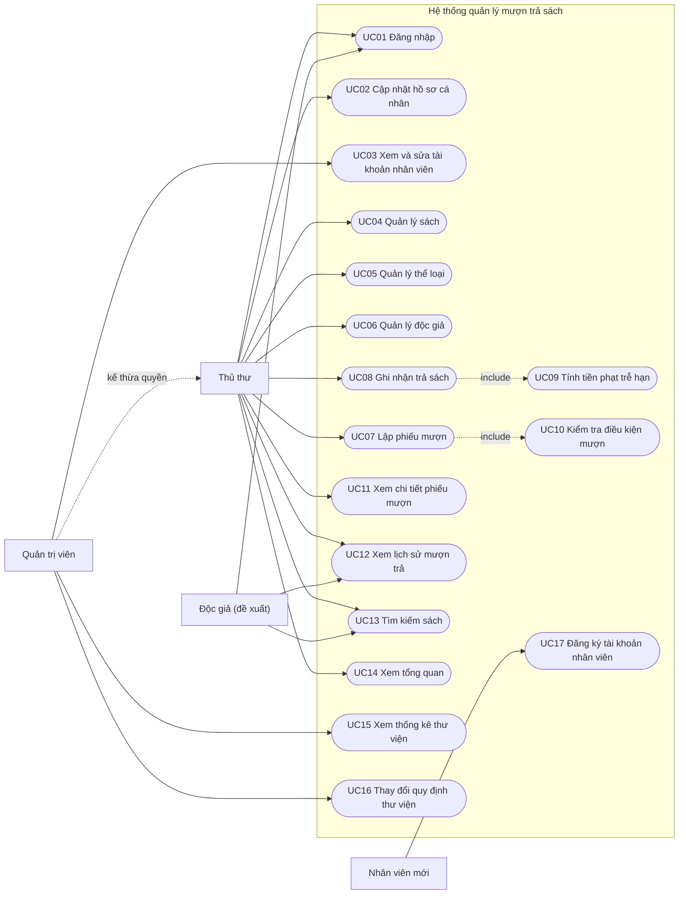

# Đặc tả Use Case – Quản lý mượn trả sách thư viện

**Người thực hiện:** Đặng Huy Quang Dũng (Product Owner)  
**Cơ sở:** đề cương (mục 1.1 đến 1.8) và mã nguồn nhánh `develop`, commit `dcc0e3d` (kèm các sửa của nhánh `feature/sprint1-ra-soat-quang-dung`). Liên kết với [PRODUCT-BACKLOG.md](PRODUCT-BACKLOG.md) và [ERD.md](ERD.md).  
**Ghi chú:** use case đánh dấu *Đề xuất* là chức năng đề cương yêu cầu nhưng code chưa có; luồng của chúng là đề xuất để nhóm xác nhận.

## 1. Tác nhân

| Tác nhân | Vai trò trong code | Mô tả |
|---|---|---|
| Thủ thư | `Nhân viên` | Nghiệp vụ quầy: quản lý hồ sơ độc giả và thẻ, tìm kiếm/quản lý sách và tồn, mượn/trả, thu phạt, xem lịch sử |
| Quản trị viên | `Quản lý` | Có toàn bộ quyền Thủ thư; quản lý tài khoản và thể loại, xóa độc giả, cập nhật quy định hệ thống và xem/in thống kê vĩ mô |
| Độc giả | chưa có | Tra cứu sách, xem lịch sử mượn của mình (đề xuất) |

## 2. Sơ đồ use case

Thủ thư được tìm kiếm sách trong mục Sách, thêm/sửa sách, loại bản hỏng/mất khỏi tồn kho có nhật ký, tạo/sửa/gia hạn hồ sơ độc giả; không xóa độc giả, quản lý thể loại, hồ sơ tài khoản nhân viên, quy định hoặc xem thống kê. Quản trị viên có toàn bộ quyền nghiệp vụ và quyền quản lý hồ sơ/tài khoản nhân viên, quy định hệ thống, thống kê mượn/trả, sách được mượn nhiều và tiền phạt đã thu. Đường dẫn gốc mở đăng nhập; không có trang tra cứu sách công khai riêng.

## 3. Danh sách use case

| ID | Tên | Tác nhân | Sprint | Trạng thái |
|---|---|---|---|---|
| UC01 | Đăng nhập | Thủ thư, Quản trị viên (Độc giả: đề xuất) | 1 | Xong |
| UC02 | Cập nhật hồ sơ cá nhân | Thủ thư, Quản trị viên | 1 | Xong |
| UC03 | Quản lý tài khoản nhân viên | Quản trị viên | 1 | Xong (sửa hồ sơ, reset mật khẩu, khóa/mở, xóa có điều kiện) |
| UC04 | Quản lý sách và tồn kho | Quản trị viên (Thủ thư thêm/sửa/điều chỉnh tồn) | 1 | Xong |
| UC05 | Quản lý thể loại | Quản trị viên (Thủ thư xem) | 1 | Xong |
| UC06 | Quản lý độc giả và thẻ | Quản trị viên, Thủ thư | 1 | Xong |
| UC07 | Lập phiếu mượn | Thủ thư | 2 | Xong |
| UC08 | Ghi nhận trả sách | Thủ thư | 2 | Xong |
| UC09 | Tính tiền phạt trễ hạn | Hệ thống | 2 | Xong |
| UC10 | Kiểm tra điều kiện mượn | Hệ thống | 2 | Xong |
| UC11 | Xem chi tiết phiếu mượn | Thủ thư | 2 | Xong |
| UC12 | Xem lịch sử mượn trả | Thủ thư, Độc giả (chỉ của mình, đề xuất) | 2, 3 | Xong cho Thủ thư |
| UC13 | Tìm kiếm sách | Thủ thư, Độc giả | 1, 3 | Một phần (chỉ theo tên, tác giả) |
| UC14 | Xem tổng quan | Thủ thư, Quản trị viên | 1 | Xong |
| UC15 | Xem thống kê thư viện | Quản trị viên | 3 | Xong |
| UC16 | Thay đổi quy định thư viện | Quản trị viên | 3 | Xong |
| UC17 | Đăng ký tài khoản nhân viên | Nhân viên mới | 1 | Xong (tự đăng ký, kích hoạt ngay với vai trò Nhân viên) |

## 4. Đặc tả chi tiết

### UC01. Đăng nhập

| Mục | Nội dung |
|---|---|
| Tác nhân | Thủ thư, Quản trị viên |
| Mô tả | Người dùng đăng nhập bằng tên tài khoản và mật khẩu để dùng hệ thống |
| Tiền điều kiện | Có tài khoản trong hệ thống qua khởi tạo ban đầu hoặc đăng ký nhân viên |
| Hậu điều kiện | Người dùng được xác thực và chuyển tới trang tổng quan theo đúng vai trò |
| Luồng chính | 1. Người dùng mở trang đăng nhập. 2. Nhập tên tài khoản, mật khẩu (có thể chọn ghi nhớ đăng nhập). 3. Hệ thống kiểm tra mật khẩu với bản băm đã lưu. 4. Hệ thống tạo phiên đăng nhập và chuyển tới trang tổng quan |
| Luồng thay thế | 3a. Sai tên hoặc mật khẩu: báo lỗi, tăng số lần sai. 3b. Sai 5 lần liên tiếp: khóa tài khoản tạm 15 phút. 3c. Tài khoản đang bị khóa: báo tài khoản tạm khóa, thử lại sau 15 phút |
| Quy tắc | Đăng nhập bằng tên tài khoản, không dùng email. Truy cập chức năng không đủ quyền thì chuyển tới trang từ chối truy cập |

### UC03. Quản lý tài khoản nhân viên

| Mục | Nội dung |
|---|---|
| Tác nhân | Thủ thư (lập/gửi); Quản trị viên (xem/đối soát) |
| Mô tả | Xem danh sách nhân viên, sửa hồ sơ, reset mật khẩu, khóa/mở hoặc xóa tài khoản nhân viên |
| Tiền điều kiện | Quản trị viên đã đăng nhập; tài khoản mục tiêu có vai trò Nhân viên |
| Hậu điều kiện | Hồ sơ/trạng thái/mật khẩu được cập nhật hoặc tài khoản bị xóa nếu không có lịch sử mượn trả |
| Luồng chính | 1. Mở danh sách nhân viên. 2. Chọn sửa hồ sơ, reset mật khẩu, khóa/mở tài khoản hoặc xóa. 3. Hệ thống kiểm tra quyền và dữ liệu, thực hiện thao tác. Mật khẩu tạm chỉ hiển thị một lần |
| Luồng thay thế | Xóa nhân viên đã lập phiếu mượn/trả thì từ chối để bảo toàn lịch sử; tài khoản không tồn tại thì báo không tìm thấy |
| Quy tắc | Chỉ Quản trị viên thao tác; màn này chỉ liệt kê tài khoản Nhân viên, không tạo tài khoản. Nhân viên tự đăng ký qua UC17 và được gán vai trò Nhân viên |

### UC17. Đăng ký tài khoản nhân viên

| Mục | Nội dung |
|---|---|
| Tác nhân | Nhân viên mới chưa đăng nhập |
| Mô tả | Tạo tài khoản để sử dụng nghiệp vụ thư viện với vai trò Nhân viên |
| Tiền điều kiện | Chưa có tài khoản dùng cùng tên đăng nhập hoặc email |
| Hậu điều kiện | Tài khoản và hồ sơ được lưu; tài khoản hoạt động ngay và có thể đăng nhập |
| Luồng chính | 1. Mở trang Đăng ký. 2. Nhập họ tên, email, tên tài khoản, mật khẩu và thông tin liên hệ. 3. Hệ thống kiểm tra dữ liệu, tính duy nhất và xác nhận mật khẩu. 4. Hệ thống lưu mật khẩu dạng hash, tạo hồ sơ nhân viên, gán cố định vai trò `Nhân viên` và chuyển tới trang đăng nhập |
| Luồng thay thế | 3a. Tên tài khoản hoặc email đã dùng: báo lỗi tương ứng và yêu cầu chọn giá trị khác |
| Quy tắc | Đăng ký công khai, không cần xét duyệt; không cho người đăng ký tự chọn vai trò hoặc tạo tài khoản `Quản lý` |

### UC04. Quản lý sách

| Mục | Nội dung |
|---|---|
| Tác nhân | Thủ thư và Quản trị viên (thêm/sửa sách, loại bản hỏng/mất khỏi tồn kho) |
| Mô tả | Quản lý danh mục đầu sách và số lượng trong kho |
| Tiền điều kiện | Đã đăng nhập. Thể loại không bắt buộc: sách chưa chọn thể loại hiển thị là "Chưa phân loại" |
| Hậu điều kiện | Dữ liệu sách trong `books.txt` được cập nhật |
| Luồng chính (thêm) | 1. Quản trị viên chọn Thêm sách. 2. Nhập tên sách, tác giả, nhà xuất bản, năm xuất bản, số lượng và chọn thể loại (nếu có). 3. Hệ thống tự cấp mã sách, kiểm tra hợp lệ và lưu sách. 4. Hiển thị thông báo thành công |
| Luồng chính (sửa, xóa khỏi kho, xem) | Sửa: chọn sách, chỉnh các trường rồi lưu. Xóa khỏi kho: chọn sách, chọn lý do và số lượng, xác nhận; hệ thống giảm tồn và lưu nhật ký. Xem: mở chi tiết sách kèm tên thể loại |
| Luồng thay thế | 3a. Thiếu tên hoặc tác giả: báo lỗi tại trường. 3b. Năm xuất bản lớn hơn năm hiện tại hoặc thể loại không tồn tại: báo lỗi tại trường. 4a. Số lượng muốn xóa vượt tồn sẵn có: không cập nhật và báo lỗi |
| Quy tắc | Tên sách tối đa 200 ký tự, tác giả 120. Năm xuất bản từ 1450 đến năm hiện tại. Số lượng 0 đến 100000. Xóa chỉ loại bản hỏng/mất khỏi tồn; không xóa đầu sách hoặc lịch sử mượn. Lưu lý do, nhân viên, số lượng và thời điểm |

### UC05. Quản lý thể loại

| Mục | Nội dung |
|---|---|
| Tác nhân | Quản trị viên (thêm, sửa, xóa); Thủ thư (xem, tìm) |
| Mô tả | Quản lý các thể loại để phân loại sách |
| Luồng chính | Thêm, sửa, xóa, xem thể loại. Chi tiết thể loại hiển thị danh sách sách thuộc thể loại |
| Luồng thay thế | Tên trùng (không phân biệt hoa thường): báo "Tên thể loại đã tồn tại". Xóa thể loại còn sách: không xóa, báo lỗi |
| Quy tắc | Tên thể loại tối đa 100 ký tự, mô tả tối đa 500 ký tự |

### UC06. Quản lý độc giả

| Mục | Nội dung |
|---|---|
| Tác nhân | Thủ thư (thêm, sửa, gia hạn, xóa hồ sơ chưa có lịch sử mượn); Quản trị viên (toàn quyền) |
| Mô tả | Quản lý thông tin độc giả để lập phiếu mượn |
| Luồng chính (thêm) | 1. Thủ thư chọn Thêm độc giả. 2. Nhập họ tên, email, số điện thoại, địa chỉ, ngày sinh. 3. Hệ thống kiểm tra tuổi theo quy định. 4. Hệ thống lưu ngày đăng ký và hạn thẻ. Thủ thư có thể cập nhật hồ sơ, gia hạn và xóa hồ sơ chưa có lịch sử mượn sau khi xác nhận |
| Luồng thay thế | Email trùng độc giả khác hoặc hồ sơ tài khoản: báo lỗi. Xóa độc giả đã có phiếu mượn: không xóa, báo lỗi |
| Quy tắc | Họ tên tối đa 120 ký tự, email hợp lệ và tối đa 256 ký tự, số điện thoại tối đa 20. Tuổi và thời hạn thẻ lấy từ quy định hệ thống. Tìm theo tên, email, điện thoại hoặc địa chỉ |

### UC07. Lập phiếu mượn

| Mục | Nội dung |
|---|---|
| Tác nhân | Thủ thư |
| Mô tả | Ghi nhận việc độc giả mượn sách và cập nhật tồn kho |
| Tiền điều kiện | Đã đăng nhập; có độc giả; có sách còn ít nhất một bản |
| Hậu điều kiện | Có phiếu mới trạng thái "Đang mượn"; số lượng sách còn giảm đúng số đã mượn |
| Luồng chính | 1. Thủ thư nhập mã độc giả và xác nhận tên tự hiển thị. 2. Nhập ngày mượn, ngày hẹn trả và chọn một hoặc nhiều sách. 3. Hệ thống hiển thị mã, tác giả, nhà xuất bản, số lượng còn; thủ thư nhập số lượng mượn. 4. Hệ thống kiểm tra tồn kho, tạo mã phiếu tự động, lưu chi tiết và trừ tồn kho. |
| Luồng thay thế | Mã độc giả/thẻ không hợp lệ, độc giả quá tuổi, quá hạn mượn hoặc còn nợ phạt/sách quá hạn, vượt hạn mức sách, ngày không hợp lệ hoặc tồn kho không đủ: không tạo phiếu và báo lỗi. |
| Quy tắc | Thời hạn mượn và số bản được giữ cùng lúc lấy từ quy định hệ thống; khoản phạt trễ trên mỗi phiếu được chụp theo mức tại thời điểm lập phiếu. Mỗi đầu sách mượn từ 1 đến 100 cuốn; nhiều đầu sách có thể cùng thuộc một phiếu |

### UC08. Ghi nhận trả sách

| Mục | Nội dung |
|---|---|
| Tác nhân | Thủ thư |
| Mô tả | Kiểm tra sách nhận lại và lập phiếu trả cho một phần hoặc toàn bộ phiếu mượn |
| Tiền điều kiện | Phiếu tồn tại và còn sách chưa trả |
| Hậu điều kiện | Có phiếu trả và chi tiết trả ghi số lượng, tình trạng, ghi chú; trạng thái phiếu mượn được cập nhật |
| Luồng chính | 1. Thủ thư tìm phiếu theo mã thẻ độc giả. 2. Chọn phiếu, kiểm tra từng đầu sách. 3. Nhập số lượng, tình trạng tốt/hư hỏng/mất và ghi chú sự cố. 4. Hệ thống tạo phiếu trả, chỉ cộng sách tốt vào tồn kho, tính phạt trễ/hỏng/mất và cập nhật trạng thái. |
| Luồng thay thế | Số lượng trả vượt số còn mượn, tình trạng không hợp lệ hoặc thiếu ghi chú cho sách hỏng/mất: không lập phiếu và báo lỗi. |
| Quy tắc | Có thể lập nhiều phiếu trả trên một phiếu mượn; sách hư hỏng/mất không cộng vào số lượng sẵn có. Tiền phạt được chốt theo từng bản sách tại mỗi lần trả. Thu tiền có thể chia nhiều lần; mỗi lần tạo phiếu thu riêng có nhân viên, thời điểm và số tiền. |

### UC09. Tính tiền phạt trễ hạn

| Mục | Nội dung |
|---|---|
| Tác nhân | Hệ thống (kích hoạt khi Thủ thư thực hiện UC08) |
| Mô tả | Khi trả sách sau hạn, hệ thống tính phạt theo số ngày trễ và quy định tại thời điểm lập phiếu mượn; cộng thêm tiền phạt hư hỏng/mất |
| Luồng chính | 1. Ghi nhận ngày trả thực tế. 2. Tính tiền trễ theo mức/ngày đã chụp trên phiếu mượn. 3. Cộng mức phạt hư hỏng/mất hiện hành. 4. Lưu tiền phạt trong chi tiết phiếu trả. |
| Quy tắc | Phạt trễ mặc định 2.000đ/cuốn/ngày; mức có thể đổi nhưng không làm thay đổi phiếu đã lập. Mức phạt hư hỏng/mất lấy từ quy định tại lúc trả và được chốt. Khi trả từng phần, chỉ phạt số sách được xử lý trong lần đó; sách chưa trả tiếp tục phát sinh phạt. |

### UC10. Kiểm tra và thanh toán nợ phạt

| Mục | Nội dung |
|---|---|
| Tác nhân | Hệ thống (kích hoạt trong UC07) |
| Mô tả | Kiểm tra thẻ, tuổi, nợ quá hạn/phạt và hạn mức mượn trước khi tạo phiếu |
| Luồng chính | 1. Hệ thống kiểm tra thẻ còn hạn, tuổi, sách quá hạn, tiền phạt và tổng sách độc giả đang giữ. 2. Nếu vi phạm điều kiện, không tạo phiếu và không trừ tồn kho. 3. Nếu hợp lệ, cho mượn trong hạn mức cấu hình |
| Luồng thay thế | Sách đang mượn nhưng chưa quá hạn vẫn được tính vào hạn mức; không chặn chỉ vì còn sách đang mượn |
| Quy tắc | Mọi kiểm tra nợ phạt và cập nhật tồn kho/phiếu mượn chạy bên trong cùng `LibraryFileStore.UpdateAsync` để đồng bộ trong một tiến trình ứng dụng. |

### UC11. Xem chi tiết phiếu mượn

| Mục | Nội dung |
|---|---|
| Tác nhân | Nhân viên, Quản lý |
| Mô tả | Xem sách, số lượng còn phải trả, thông tin độc giả và lịch sử trả/phạt/thanh toán của một phiếu |
| Luồng chính | 1. Chọn mã phiếu trong danh sách. 2. Hệ thống hiển thị thông tin phiếu mượn và từng đầu sách. 3. Hiển thị từng phiếu trả, tiền phạt đã chốt, số đã thu và số còn nợ. 4. Với khoản còn nợ, nhân viên xác nhận thu tiền từ màn hình chi tiết |
| Luồng thay thế | Mã phiếu không tồn tại: trả về trang không tìm thấy |

### UC12. Xem lịch sử mượn trả

| Mục | Nội dung |
|---|---|
| Tác nhân | Thủ thư (xem của bất kỳ độc giả); Độc giả (chỉ xem của mình, khi có tài khoản Độc giả - đề xuất) |
| Mô tả | Xem các phiếu mượn của một độc giả kèm sách, ngày mượn, hạn trả, trạng thái |
| Luồng chính | 1. Chọn độc giả (Thủ thư) hoặc mở trang cá nhân (Độc giả). 2. Hệ thống liệt kê phiếu theo thời gian mới nhất trước. 3. Hiển thị trạng thái Đang mượn, Quá hạn, Đã trả |
| Luồng thay thế | Độc giả chưa có phiếu nào: hiển thị thông báo trống |

### UC13. Tìm kiếm sách

| Mục | Nội dung |
|---|---|
| Tác nhân | Thủ thư (hiện có); Độc giả (đề xuất, Sprint 3) |
| Mô tả | Tìm sách trong danh mục |
| Luồng chính | 1. Nhập từ khóa. 2. Hệ thống lọc sách theo tên hoặc tác giả, không phân biệt hoa thường. 3. Hiển thị danh sách sắp xếp theo tên sách |
| Luồng thay thế | Không có kết quả: hiển thị "Không tìm thấy sách phù hợp" |
| Mở rộng (Sprint 3) | Lọc thêm theo thể loại, năm xuất bản; tìm không phân biệt dấu tiếng Việt |

### UC15. Xem thống kê thư viện

| Mục | Nội dung |
|---|---|
| Tác nhân | Quản trị viên |
| Mô tả | Xem thống kê tổng hợp hoạt động thư viện theo khoảng ngày |
| Luồng chính | 1. Chọn ngày bắt đầu và kết thúc. 2. Hệ thống hiển thị số phiếu mượn, phiếu trả và tiền phạt thực thu trong kỳ. 3. Hệ thống thể hiện xu hướng mượn theo tháng, trạng thái hiện tại của các phiếu trong kỳ, top 5 sách được mượn nhiều và 10 phiếu gần đây. 4. Quản trị viên có thể in báo cáo. |
| Quy tắc | Chỉ Quản trị viên được xem thống kê. Ngày kết thúc được tính trọn ngày; tiền phạt dựa trên số tiền đã thu trong kỳ, không phải tiền còn nợ. Tổng quan vẫn hiển thị số liệu hiện tại không lọc ngày |

### UC16. Thay đổi quy định thư viện

| Mục | Nội dung |
|---|---|
| Tác nhân | Quản trị viên |
| Mô tả | Cập nhật các tham số tác động đến giao dịch mới |
| Tham số | Số ngày mượn, số bản tối đa/độc giả, mức phạt trễ/ngày, phạt sách hư hỏng/mất, tuổi tối thiểu/tối đa và thời hạn thẻ |
| Mặc định | 14 ngày, 5 bản, 2.000đ/ngày, 50.000đ hư hỏng, 100.000đ mất, 6–100 tuổi, thẻ 12 tháng |
| Quy tắc | Thay đổi không sửa hạn trả hoặc tiền phạt đã chốt; mức phạt/ngày được lưu theo từng phiếu mượn |

## 5. Quy tắc nghiệp vụ chung

| Mã | Quy tắc |
|---|---|
| BR-01 | Số lượng sách trong kho không âm; mượn làm giảm, trả làm tăng đúng số lượng trên phiếu |
| BR-02 | Thao tác Xóa sách chỉ giảm số bản khỏi tồn kho, giữ nguyên đầu sách và lịch sử; không xóa độc giả đã có phiếu mượn hoặc thể loại còn sách |
| BR-03 | Email độc giả, tên thể loại không được trùng |
| BR-04 | Hạn trả không được trước ngày lập phiếu |
| BR-05 | Phiếu quá hạn là phiếu chưa trả mà hạn trả đã qua |
| BR-06 | Thủ thư được thêm/sửa sách, loại bản hỏng/mất khỏi tồn kho có nhật ký, tạo/sửa/gia hạn độc giả; chỉ Quản trị viên xóa độc giả, quản lý thể loại, tài khoản, quy định và xem thống kê vĩ mô |
| BR-07 | Mặc định: 14 ngày mượn, tối đa 5 bản/độc giả, 2.000đ phạt/bản/ngày, tuổi 6–100 và thẻ 12 tháng; cấu hình chỉ Quản trị viên sửa |
| BR-08 | Sách hư hỏng/mất không trở lại tồn kho; mỗi lần thu tiền phạt tạo một phiếu thu có số tiền, thời gian và người thu |
