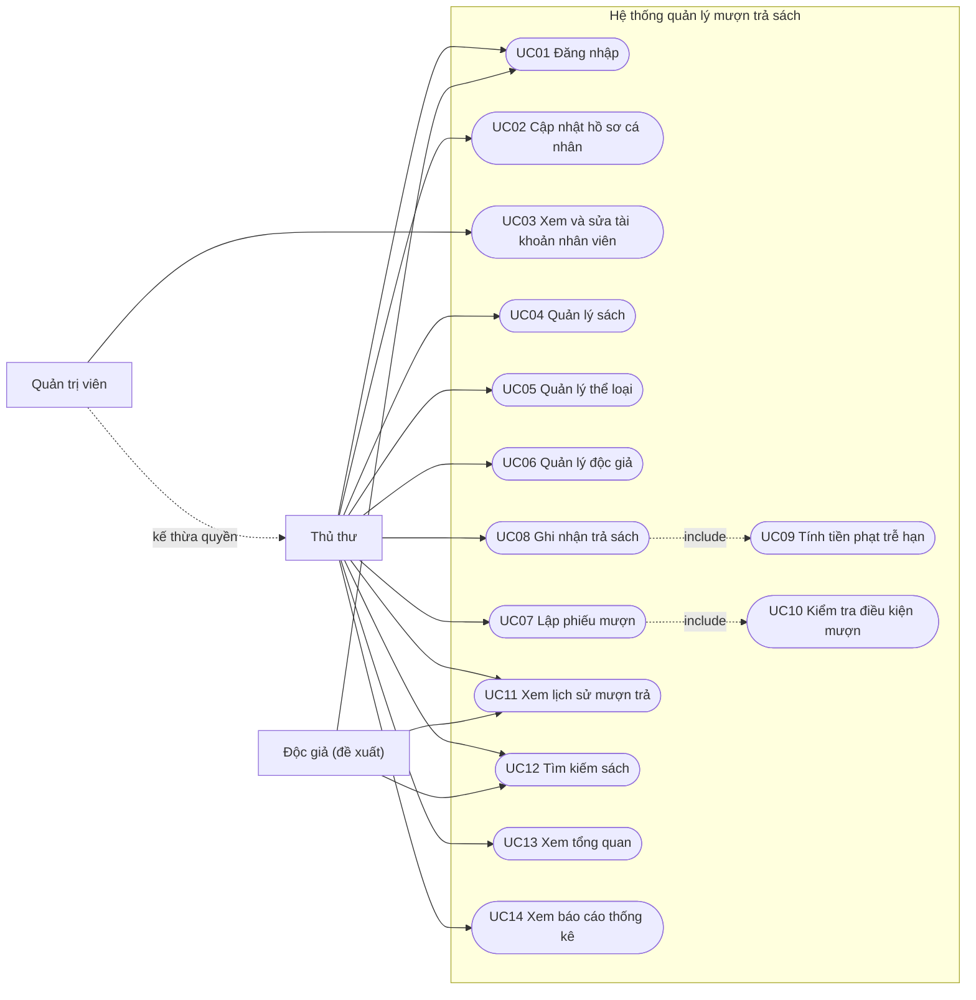

# Đặc tả Use Case – Quản lý mượn trả sách thư viện

**Người thực hiện:** Đặng Huy Quang Dũng (Product Owner)  
**Cơ sở:** đề cương (mục 1.1 đến 1.8) và mã nguồn nhánh `develop`, commit `1530ba4`. Liên kết với [PRODUCT-BACKLOG.md](PRODUCT-BACKLOG.md) và [ERD.md](ERD.md).  
**Ghi chú:** use case đánh dấu *Đề xuất* là chức năng đề cương yêu cầu nhưng code chưa có; luồng của chúng là đề xuất để nhóm xác nhận.

## 1. Tác nhân

| Tác nhân | Vai trò trong code | Mô tả |
|---|---|---|
| Thủ thư | `Nhân viên` | Xem danh mục, lập phiếu mượn, ghi nhận trả sách, xem báo cáo |
| Quản trị viên | `Quản lý` | Có toàn bộ quyền của Thủ thư, ngoài ra thêm/sửa/xóa sách, thể loại, độc giả và xem danh sách tài khoản nhân viên |
| Độc giả | chưa có | Tra cứu sách, xem lịch sử mượn của mình (đề xuất) |

## 2. Sơ đồ use case

Thủ thư chỉ **xem** ở UC04, UC05, UC06; Quản trị viên mới được thêm, sửa, xóa.

## 3. Danh sách use case

| ID | Tên | Tác nhân | Sprint | Trạng thái |
|---|---|---|---|---|
| UC01 | Đăng nhập | Thủ thư, Quản trị viên (Độc giả: đề xuất) | 1 | Xong |
| UC02 | Cập nhật hồ sơ cá nhân | Thủ thư, Quản trị viên | 1 | Xong |
| UC03 | Xem và sửa tài khoản nhân viên | Quản trị viên | 1 | Xong |
| UC04 | Quản lý sách | Quản trị viên (Thủ thư xem) | 1 | Xong |
| UC05 | Quản lý thể loại | Quản trị viên (Thủ thư xem) | 1 | Xong |
| UC06 | Quản lý độc giả | Quản trị viên (Thủ thư xem) | 1 | Xong |
| UC07 | Lập phiếu mượn | Thủ thư | 2 | Một phần |
| UC08 | Ghi nhận trả sách | Thủ thư | 2 | Một phần |
| UC09 | Tính tiền phạt trễ hạn | Hệ thống | 2 | Đề xuất |
| UC10 | Kiểm tra điều kiện mượn | Hệ thống | 2 | Đề xuất |
| UC11 | Xem lịch sử mượn trả | Thủ thư, Độc giả | 2, 3 | Đề xuất |
| UC12 | Tìm kiếm sách | Thủ thư, Độc giả | 1, 3 | Một phần (chỉ theo tên, tác giả) |
| UC13 | Xem tổng quan | Thủ thư, Quản trị viên | 1 | Xong |
| UC14 | Xem báo cáo thống kê | Thủ thư, Quản trị viên | 3 | Một phần |

## 4. Đặc tả chi tiết

### UC01. Đăng nhập

| Mục | Nội dung |
|---|---|
| Tác nhân | Thủ thư, Quản trị viên |
| Mô tả | Người dùng đăng nhập bằng tên tài khoản và mật khẩu để dùng hệ thống |
| Tiền điều kiện | Có tài khoản trong hệ thống. Tài khoản hiện do hệ thống tạo sẵn, không đăng ký công khai |
| Hậu điều kiện | Người dùng được xác thực và chuyển tới trang tổng quan theo đúng vai trò |
| Luồng chính | 1. Người dùng mở trang đăng nhập. 2. Nhập tên tài khoản, mật khẩu (có thể chọn ghi nhớ đăng nhập). 3. Hệ thống kiểm tra mật khẩu với bản băm đã lưu. 4. Hệ thống tạo phiên đăng nhập và chuyển tới trang tổng quan |
| Luồng thay thế | 3a. Sai tên hoặc mật khẩu: báo lỗi, tăng số lần sai. 3b. Sai 5 lần liên tiếp: khóa tài khoản tạm 15 phút. 3c. Tài khoản đang bị khóa: báo tài khoản tạm khóa, thử lại sau 15 phút |
| Quy tắc | Đăng nhập bằng tên tài khoản, không dùng email. Truy cập chức năng không đủ quyền thì chuyển tới trang từ chối truy cập |

### UC04. Quản lý sách

| Mục | Nội dung |
|---|---|
| Tác nhân | Nhân viên và Quản lý (thêm, sửa, xóa, xem, tìm) |
| Mô tả | Quản lý danh mục đầu sách và số lượng trong kho |
| Tiền điều kiện | Đã đăng nhập. Muốn thêm hoặc sửa phải có ít nhất một thể loại |
| Hậu điều kiện | Dữ liệu sách trong `books.txt` được cập nhật |
| Luồng chính (thêm) | 1. Nhân viên hoặc Quản lý chọn Thêm sách. 2. Nhập tên sách, tác giả, nhà xuất bản, năm xuất bản, số lượng. 3. Hệ thống tự cấp mã sách, kiểm tra hợp lệ và lưu sách. 4. Hiển thị thông báo thành công |
| Luồng chính (sửa, xóa, xem) | Sửa: chọn sách, chỉnh các trường rồi lưu. Xóa: chọn sách, xác nhận ở trang xác nhận. Xem: mở chi tiết sách kèm tên thể loại |
| Luồng thay thế | 3a. Thiếu tên hoặc tác giả: báo lỗi tại trường. 4a. Xóa sách đã có trong phiếu mượn: không xóa, báo lỗi |
| Quy tắc | Tên sách tối đa 200 ký tự, tác giả 120. Năm xuất bản 1450 đến 2200. Số lượng 0 đến 100000 |

### UC05. Quản lý thể loại

| Mục | Nội dung |
|---|---|
| Tác nhân | Quản trị viên (thêm, sửa, xóa); Thủ thư (xem, tìm) |
| Mô tả | Quản lý các thể loại để phân loại sách |
| Luồng chính | Thêm, sửa, xóa, xem thể loại. Chi tiết thể loại hiển thị danh sách sách thuộc thể loại |
| Luồng thay thế | Tên trùng (không phân biệt hoa thường): báo "Tên thể loại đã tồn tại". Xóa thể loại còn sách: không xóa, báo lỗi |
| Quy tắc | Tên thể loại tối đa 100 ký tự, mô tả tối đa 500 ký tự |

### UC06. Quản lý độc giả

| Mục | Nội dung |
|---|---|
| Tác nhân | Quản trị viên (thêm, sửa, xóa); Thủ thư (xem, tìm) |
| Mô tả | Quản lý thông tin độc giả để lập phiếu mượn |
| Luồng chính (thêm) | 1. Quản trị viên chọn Thêm độc giả. 2. Nhập họ tên, email, số điện thoại, địa chỉ. 3. Hệ thống kiểm tra hợp lệ. 4. Hệ thống lưu và gán ngày đăng ký là thời điểm hiện tại |
| Luồng thay thế | Email trùng độc giả khác hoặc hồ sơ tài khoản: báo lỗi. Xóa độc giả đã có phiếu mượn: không xóa, báo lỗi |
| Quy tắc | Họ tên tối đa 120 ký tự, email hợp lệ và tối đa 256 ký tự, số điện thoại tối đa 20. Tìm theo họ tên hoặc email |

### UC07. Lập phiếu mượn

| Mục | Nội dung |
|---|---|
| Tác nhân | Thủ thư |
| Mô tả | Ghi nhận việc độc giả mượn sách và cập nhật tồn kho |
| Tiền điều kiện | Đã đăng nhập; có độc giả; có sách còn ít nhất một bản |
| Hậu điều kiện | Có phiếu mới trạng thái "Đang mượn"; số lượng sách còn giảm đúng số đã mượn |
| Luồng chính | 1. Thủ thư chọn độc giả, sách, số lượng, hạn trả. 2. Hệ thống kiểm tra điều kiện. 3. Hệ thống tạo phiếu (ghi nhân viên lập và ngày mượn là hiện tại), tạo chi tiết phiếu và trừ số lượng sách. 4. Hiển thị thông báo thành công |
| Luồng thay thế | 2a. Độc giả hoặc sách không tồn tại, số lượng mượn lớn hơn số còn, hạn trả trước hôm nay: không tạo phiếu, báo lỗi chung. 2b. Độc giả không đủ điều kiện (xem UC10): từ chối *(đề xuất)* |
| Quy tắc | Số lượng mượn 1 đến 100. Phiếu hiện chứa một đầu sách; mô hình dữ liệu cho phép nhiều dòng chi tiết, nên có thể mở rộng nhiều sách trên một phiếu |

### UC08. Ghi nhận trả sách

| Mục | Nội dung |
|---|---|
| Tác nhân | Thủ thư |
| Mô tả | Đóng phiếu mượn khi độc giả trả sách |
| Tiền điều kiện | Phiếu tồn tại và chưa ở trạng thái "Đã trả" |
| Hậu điều kiện | Phiếu chuyển "Đã trả"; số lượng sách được cộng lại vào kho |
| Luồng chính | 1. Thủ thư chọn phiếu cần trả. 2. Hệ thống cộng lại số lượng từng sách trên phiếu. 3. Hệ thống đặt trạng thái "Đã trả" và báo thành công |
| Luồng thay thế | Phiếu không tồn tại hoặc đã trả: báo "Không tìm thấy phiếu mượn đang hoạt động". Phiếu có chi tiết sách không hợp lệ: báo lỗi dữ liệu |
| Quy tắc | Trạng thái "Quá hạn" được tính khi hiển thị: phiếu chưa trả và hạn trả trước hôm nay. *Chưa ghi ngày trả thực tế và chưa tính phạt (xem UC09)* |

### UC09. Tính tiền phạt trễ hạn *(Đề xuất, Sprint 2)*

| Mục | Nội dung |
|---|---|
| Tác nhân | Hệ thống (kích hoạt khi Thủ thư thực hiện UC08) |
| Mô tả | Khi trả sách sau hạn, hệ thống tính tiền phạt lũy tiến theo số ngày trễ |
| Luồng chính | 1. Ghi nhận ngày trả thực tế. 2. Nếu ngày trả sau hạn trả, tính số ngày trễ. 3. Áp mức phạt lũy tiến để ra tiền phạt. 4. Lưu tiền phạt vào chi tiết phiếu trả (`ChiTietPhieuTra.TienPhat` trong ERD 3NF). 5. Hiển thị tiền phạt cho Thủ thư |
| Quy tắc | Mức phạt theo ngày chưa được nhóm chốt. Tiền phạt lưu tại thời điểm trả để thay đổi mức phạt sau này không làm sai lịch sử |

### UC10. Kiểm tra điều kiện mượn *(Đề xuất, Sprint 2)*

| Mục | Nội dung |
|---|---|
| Tác nhân | Hệ thống (kích hoạt trong UC07) |
| Mô tả | Chặn lập phiếu khi độc giả không đủ điều kiện |
| Luồng chính | 1. Khi lập phiếu, hệ thống tìm các phiếu của độc giả chưa trả. 2. Nếu có phiếu quá hạn hoặc còn nợ tiền phạt, hệ thống từ chối và nêu lý do. 3. Nếu không, cho phép tiếp tục |
| Quy tắc | Chưa chốt: có giới hạn số sách mượn cùng lúc hay không, và nợ phạt xác định thế nào khi UC09 hoàn thành |

### UC11. Xem lịch sử mượn trả *(Đề xuất, Sprint 2 và 3)*

| Mục | Nội dung |
|---|---|
| Tác nhân | Thủ thư (xem của bất kỳ độc giả); Độc giả (chỉ xem của mình, khi có tài khoản Độc giả) |
| Mô tả | Xem các phiếu mượn của một độc giả kèm sách, ngày mượn, hạn trả, trạng thái |
| Luồng chính | 1. Chọn độc giả (Thủ thư) hoặc mở trang cá nhân (Độc giả). 2. Hệ thống liệt kê phiếu theo thời gian mới nhất trước. 3. Hiển thị trạng thái Đang mượn, Quá hạn, Đã trả |
| Luồng thay thế | Độc giả chưa có phiếu nào: hiển thị thông báo trống |

### UC12. Tìm kiếm sách

| Mục | Nội dung |
|---|---|
| Tác nhân | Thủ thư (hiện có); Độc giả (đề xuất, Sprint 3) |
| Mô tả | Tìm sách trong danh mục |
| Luồng chính | 1. Nhập từ khóa. 2. Hệ thống lọc sách theo tên hoặc tác giả, không phân biệt hoa thường. 3. Hiển thị danh sách sắp xếp theo tên sách |
| Luồng thay thế | Không có kết quả: hiển thị "Không tìm thấy sách phù hợp" |
| Mở rộng (Sprint 3) | Lọc thêm theo thể loại, năm xuất bản; tìm không phân biệt dấu tiếng Việt |

### UC14. Xem báo cáo thống kê

| Mục | Nội dung |
|---|---|
| Tác nhân | Thủ thư, Quản trị viên |
| Mô tả | Xem số liệu tổng hợp tình hình thư viện |
| Hiện có | Số đầu sách, số bản còn trong kho, số thể loại, số độc giả, tổng số phiếu, số phiếu đang mượn, quá hạn, đã trả |
| Mở rộng (Sprint 3) | Thống kê lượt mượn theo sách và thời gian, danh sách sách quá hạn, biểu đồ |

## 5. Quy tắc nghiệp vụ chung

| Mã | Quy tắc |
|---|---|
| BR-01 | Số lượng sách trong kho không âm; mượn làm giảm, trả làm tăng đúng số lượng trên phiếu |
| BR-02 | Không xóa sách, độc giả đã có phiếu mượn; không xóa thể loại còn sách |
| BR-03 | Email độc giả, tên thể loại không được trùng |
| BR-04 | Hạn trả không được trước ngày lập phiếu |
| BR-05 | Phiếu quá hạn là phiếu chưa trả mà hạn trả đã qua |
| BR-06 | Chỉ Quản trị viên được thêm, sửa, xóa danh mục; Thủ thư chỉ xem |
