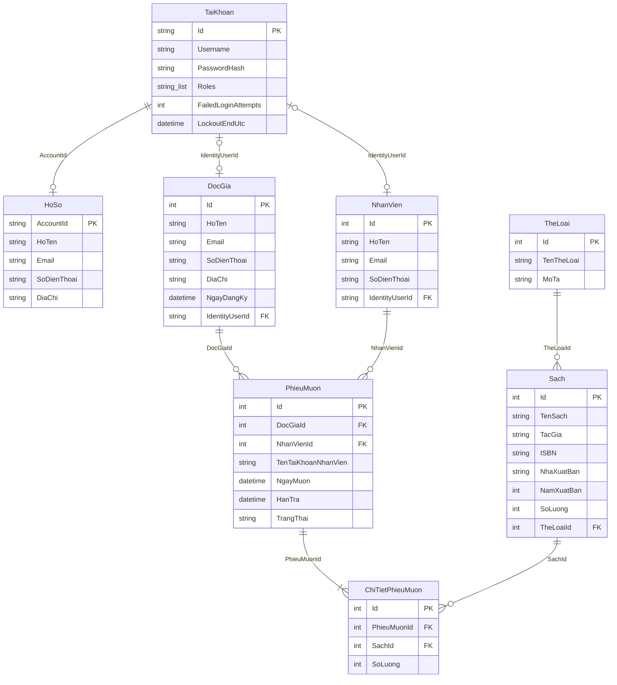
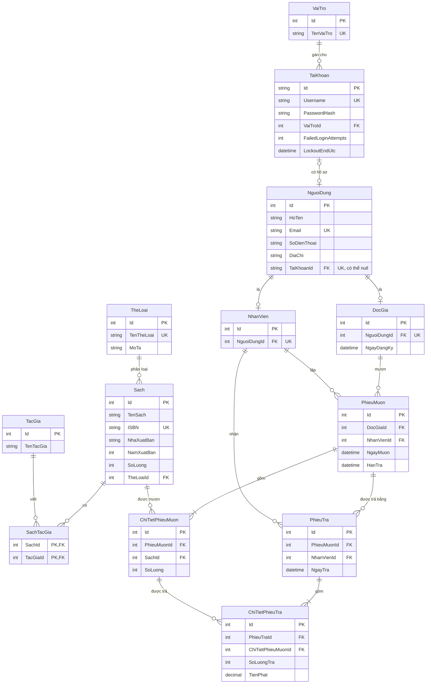

# ERD chuẩn 3NF – Sprint 0

**Người thực hiện:** Đặng Huy Quang Dũng  
**Cơ sở:** nhánh `develop`, commit `1530ba4` (mã nguồn nền của Đỗ Phương Anh)  
**Lưu trữ:** tệp text JSON Lines trong thư mục `database` (không dùng SQL), xem [CAU-TRUC-DU-LIEU.md](CAU-TRUC-DU-LIEU.md).

## 1. Khảo sát dữ liệu

Đối chiếu `Models/`, `Data/LibraryData.cs`, `Data/LibraryFileStore.cs` và các controller để xác định 8 tập dữ liệu hiện có.

| Tệp trong `database` | Lớp C# | Ý nghĩa |
|---|---|---|
| `users.txt` | `LibraryAccount` | Tài khoản đăng nhập, hash mật khẩu, vai trò |
| `profiles.txt` | `LibraryUserProfile` | Hồ sơ cá nhân của tài khoản |
| `readers.txt` | `DocGia` | Độc giả |
| `staff.txt` | `NhanVien` | Nhân viên thư viện |
| `categories.txt` | `TheLoai` | Thể loại sách |
| `books.txt` | `Sach` | Đầu sách và số lượng còn |
| `loans.txt` | `PhieuMuon` | Phiếu mượn |
| `loan-details.txt` | `ChiTietPhieuMuon` | Sách và số lượng trên từng phiếu |

## 2. ERD hiện trạng (theo đúng tên trong code)

## 3. Điểm chưa đạt 3NF trong thiết kế hiện trạng

| # | Vị trí | Vấn đề | Dạng chuẩn bị vi phạm |
|---|---|---|---|
| 1 | `Sach.TacGia` | Một ô chứa nhiều tác giả, ví dụ `"David Thomas, Andrew Hunt"` | 1NF (thuộc tính đa trị) |
| 2 | `HoSo`, `DocGia`, `NhanVien` | `HoTen`, `Email`, `SoDienThoai` lặp ở cả ba nơi khi một người có tài khoản. `DocGiaController.Edit` phải tự đồng bộ sang hồ sơ | 3NF (dữ liệu dư, phụ thuộc bắc cầu qua `IdentityUserId`) |
| 3 | `PhieuMuon.TenTaiKhoanNhanVien` | Suy ra được từ `NhanVienId` rồi `IdentityUserId` rồi `Username` | 3NF (phụ thuộc bắc cầu) |
| 4 | `PhieuMuon.TrangThai` | `QuaHan` suy ra từ `HanTra` và ngày hiện tại. `MuonTraController` đã tự tính khi hiển thị, nên giá trị lưu dễ lệch | Thuộc tính suy diễn |
| 5 | Không có thực thể trả sách | Tài liệu yêu cầu phiếu trả và tiền phạt trễ hạn, nhưng chưa có nơi ghi ngày trả, số lượng trả, tiền phạt | Thiếu thực thể |
| 6 | `Roles` | Code dùng `Quản lý` và `Nhân viên`. Tài liệu đề cương nêu Thủ thư, Độc giả, Quản trị viên | Chưa thống nhất |

## 4. ERD chuẩn 3NF (mục tiêu)

### Cách xử lý từng điểm ở mục 3

| Điểm | Cách xử lý trong ERD 3NF |
|---|---|
| 1 | Tách `TacGia` và bảng nối `SachTacGia` (nhiều–nhiều) |
| 2 | Thêm `NguoiDung` giữ họ tên, email, SĐT, địa chỉ. `DocGia` và `NhanVien` chỉ giữ thông tin riêng và trỏ về `NguoiDung`. Một người vừa là độc giả vừa là nhân viên chỉ có một hồ sơ |
| 3 | Bỏ `TenTaiKhoanNhanVien` |
| 4 | Bỏ `TrangThai`. Trạng thái tính từ `HanTra`, ngày hiện tại và tổng `SoLuongTra` so với tổng `SoLuong` |
| 5 | Thêm `PhieuTra` và `ChiTietPhieuTra`, cho phép trả từng phần. `TienPhat` được lưu vì là số tiền đã chốt tại thời điểm trả, mức phạt đổi sau này không làm sai lịch sử |
| 6 | Tách `VaiTro` thành bảng riêng để đổi hoặc mở rộng vai trò mà không sửa cấu trúc |

### Kiểm tra 3NF

- **1NF:** mọi thuộc tính đơn trị sau khi tách `TacGia`.
- **2NF:** mọi bảng có khóa chính một cột. `SachTacGia` có khóa kép nhưng không có thuộc tính ngoài khóa.
- **3NF:** không còn thuộc tính phụ thuộc bắc cầu vào khóa chính.

### Ràng buộc nghiệp vụ

- Duy nhất (không phân biệt hoa thường): `TaiKhoan.Username`, `NguoiDung.Email`, `Sach.ISBN` (khi có), `TheLoai.TenTheLoai`.
- `Sach.SoLuong >= 0`; `Sach.NamXuatBan` trong khoảng 1450 đến 2200 (khớp `[Range]` hiện tại).
- `PhieuMuon.HanTra >= NgayMuon`; `ChiTietPhieuMuon.SoLuong > 0`.
- `ChiTietPhieuTra.SoLuongTra` không vượt số lượng mượn chưa trả của dòng tương ứng.
- Không xóa `Sach`, `DocGia`, `NhanVien` đang được phiếu mượn tham chiếu; không xóa `TheLoai` còn sách. Các điều kiện này code hiện tại đã chặn.

## 5. Ánh xạ ERD 3NF sang tệp hiện tại

ERD ở mục 4 là mô hình mục tiêu. Code hiện tại chưa cần đổi ngay. Bảng sau cho biết từng thực thể mới nằm ở đâu.

| ERD 3NF | Tệp hiện tại | Ghi chú |
|---|---|---|
| `TaiKhoan`, `VaiTro` | `users.txt` | `Roles` hiện là danh sách một phần tử |
| `NguoiDung` | `profiles.txt`, `readers.txt`, `staff.txt` | Gộp phần thông tin cá nhân dùng chung |
| `DocGia`, `NhanVien` | `readers.txt`, `staff.txt` | Giữ `Id`, bỏ trường cá nhân lặp |
| `TheLoai` | `categories.txt` | Giữ nguyên |
| `Sach`, `TacGia`, `SachTacGia` | `books.txt` | Tách chuỗi `TacGia` |
| `PhieuMuon`, `ChiTietPhieuMuon` | `loans.txt`, `loan-details.txt` | Bỏ `TrangThai`, `TenTaiKhoanNhanVien` |
| `PhieuTra`, `ChiTietPhieuTra` | chưa có | Thuộc Sprint 2 (nghiệp vụ trả sách và tính phạt) |

## 6. Câu hỏi cần chốt với nhóm

1. **`Sach.SoLuong`:** hiện là số còn lại và bị trừ khi lập phiếu. ERD này giữ nguyên ý nghĩa đó để khớp `MuonTraController`. Nếu muốn tách thành tổng số và số còn lại thì cần thống nhất với Phương Anh (Sprint 2).
2. **Mức phạt lũy tiến:** dùng hằng số trong code hay bảng quy định riêng (ảnh hưởng `ChiTietPhieuTra.TienPhat`)?
3. **Tên vai trò:** thống nhất giữa tài liệu (Thủ thư, Độc giả, Quản trị viên) và code (Quản lý, Nhân viên).
